<!-- ========== ANIMATED HEADER ========== -->

  

<!-- ========== INTRODUCTION ========== -->
<h1 align="center">Hi 👋, I'm Anmol Sandhu</h1>

<h3 align="center">
  BCA Student | Aspiring Data Analyst | Python Learner
</h3>

  Learning to transform raw data into meaningful insights
  through Python, data analysis, and visualization.

  

---

<!-- ========== ABOUT ME SVG ========== -->

  

### 👨‍💻 About Me

- 🎓 Currently pursuing a Bachelor of Computer Applications (BCA).
- 📊 Focused on learning Data Analytics and Exploratory Data Analysis (EDA).
- 🐍 Learning Python, NumPy, and Pandas.
- 📈 Interested in data cleaning, analysis, and visualization.
- 💻 Building practical projects to improve my technical skills.
- 🌱 Learning step by step and exploring real-world datasets.
- 🎯 Goal: Build a career in Data Analytics and grow as a technology professional.

---

<!-- ========== TECHNICAL SKILLS SVG ========== -->

  

### 🛠️ Technologies & Tools

  

  
  
  

---

<!-- ========== PROJECTS ========== -->
## 🚀 Featured Projects

| Project | Description |
|---|---|
| 📊 Student Result Analyzer | A Python-based project for analyzing student results. |
| 📚 Library Desk | A library automation project. |
| 🔐 PassForge | A password-related utility project. |
| 📈 Data Analytics Projects | Exploring data cleaning, analysis, and visualization. |

Explore more projects on my **[GitHub Repositories](https://github.com/ANMOLSANDHU0065?tab=repositories)**.

---

<!-- ========== GITHUB STATS SVG ========== -->

  

### 📊 GitHub Activity

  
  

---

### 🤝 Connect With Me

  
  

  💡 Learn • Build • Analyze • Improve

<!-- ========== ANIMATED FOOTER ========== -->

  

